# Отчёт по лабораторной работе № 3

**по дисциплине «Цифровые технологии и искусственный интеллект»**

|  |  |
|---|---|
| Выполнил | ст. гр. ИВТ-ИСУ-104Б, Акобян С. К. |
| Проверил | Преподаватель кафедры АСУ Зиязетдинов Д.С. |
| Университет | ФГБОУ ВО «Уфимский университет науки и технологий», кафедра технической кибернетики |

Уфа 2026

## Цель работы

Построить схему алгоритма в Draw.io и Mermaid, описать взаимодействие участников с помощью UML-диаграммы последовательности и составить интеллект-карту профессии программиста в PlantUML.

## Ход работы

Алгоритм — это конечный порядок действий, по которому из входных данных получают результат. Слово происходит от имени среднеазиатского математика аль-Хорезми. На схеме порядок действий задают стрелки, а форма блока показывает его смысл: скруглённый прямоугольник (терминатор) — начало и конец, прямоугольник — действие, ромб — проверка условия, параллелограмм — ввод и вывод. Обозначения и правила оформления описаны в ГОСТ 19.701-90. Ошибка новичков — рисовать начало и конец обычным овалом: нужен блок Terminator из палитры Flowchart.

Для первой схемы взят один шаг — присвоить переменной начальное значение. В Draw.io между терминаторами «Начало» и «Конец» помещён прямоугольный блок «Установить балл = 0», обе стрелки направлены вниз.

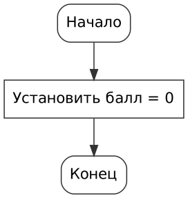

*Рисунок 1 – Линейный алгоритм (схема Draw.io, файлы linear.dot и linear.svg)*

### Сохранение схемы и сравнение форматов

В Draw.io схему можно сохранить в четырёх форматах (File → Export as / Save as). XML (.drawio) хранит блоки и их связи и нужен для дальнейшего редактирования. PNG — растровая картинка, удобная для вставки в Word. SVG — векторный формат, контуры остаются чёткими при любом увеличении. HTML содержит модель схемы и подключает средство просмотра.

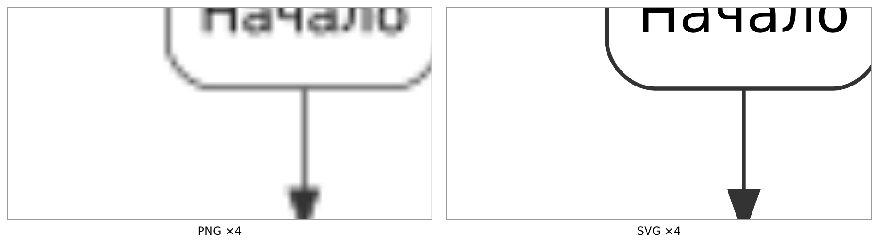

*Рисунок 2 – Один фрагмент схемы (надпись «Начало») при увеличении в четыре раза: PNG и SVG*

На рисунке видно различие: у PNG при увеличении появляются размытые края и ступеньки на границах букв, у SVG линии и текст остаются резкими. Поэтому для печати и документов лучше SVG, а PNG — когда нужна простая картинка.

Ту же линейную схему можно задать тремя строками кода Mermaid. Узлы A и C имеют форму терминатора, узел B — действие; он встречается в двух строках и соединяет начало с концом.

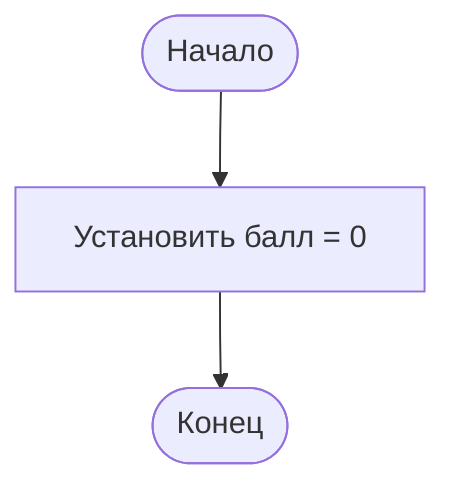

В Word вставляют готовую картинку. В Markdown на GitHub можно либо подключить файл SVG записью , либо вставить сам код в блок mermaid — тогда правка текста сразу меняет схему при следующем просмотре.

### Проверка результата теста в Mermaid

Усложним задачу. На вход поступает целый балл b от 0 до 100. При 60 баллах и выше нужно вывести «зачёт», при меньшем значении — «незачёт». Допустимость входа считаем проверенной заранее, поэтому в схеме одно условие.

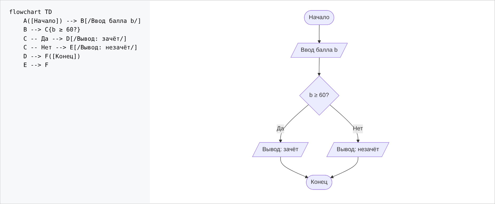

*Рисунок 3 – Код Mermaid и обе ветви алгоритма*

Запись flowchart TD задаёт направление сверху вниз. В ромбе C проверяется условие b ≥ 60. Переход с подписью «Да» ведёт к выводу «зачёт», переход «Нет» — к выводу «незачёт». После вывода обе ветви сходятся в одном блоке «Конец».

При b = 60 выполняется ветвь «Да». Если заменить знак ≥ на >, ответ изменится именно для 60 баллов, поэтому при проверке нужно взять значения по обе стороны порога: 59 и 60.

### Диаграмма в Markdown и VS Code

В файле score.md описание алгоритма помещено между строками из трёх обратных апострофов, после открывающих указано слово mermaid. Такой блок GitHub отображает как схему; в VS Code то же можно увидеть в предпросмотре Markdown с расширением Markdown Preview Mermaid Support.

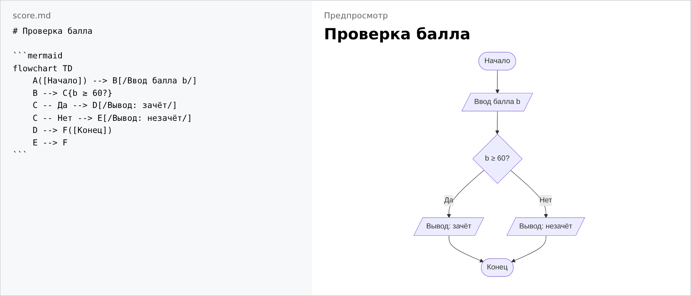

*Рисунок 4 – Исходный Markdown (слева) и построенная по нему схема (справа)*

Слева текст и метки переходов, справа ромб с тем же условием и две стрелки с подписями. Заголовок страницы и диаграмма получены из одного файла.

В комплекте с отчётом сохранён README.md (lab3.md): Mermaid-схемы включены в него как код, а карта и UML-диаграмма — как изображения с относительными путями. Файлы PlantUML приложены в виде текста рядом для редактирования.

### Блокнот для Google Colab и проверка алгоритма

В блокноте 06-score.ipynb исходный текст Mermaid хранится в многострочной строке Python. Текст кодируется в UTF-8, переводится в URL-безопасный Base64, и из результата формируется ссылка на SVG через сервис Mermaid Ink; для редактора Mermaid Live строка дополнительно сжимается. Вызов сервиса по адресу — пример REST API: вся информация в запросе.

```python
import base64

mm = """flowchart TD
    A([Начало]) --> B[/Ввод балла b/]
    ..."""
ink = "https://mermaid.ink/svg/" + base64.urlsafe_b64encode(mm.encode("utf8")).decode("ascii")
```

Вторая ячейка проверяет сам алгоритм. Функция result повторяет условие из ромба, оператор assert для каждого входа сравнивает вычисленную строку с ожидаемой, а результат выводится после успешной проверки.

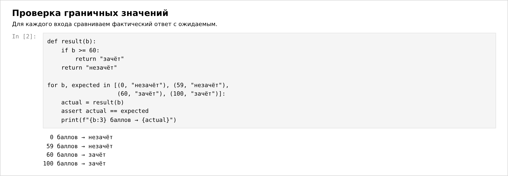

*Рисунок 5 – Ячейка блокнота с четырьмя проверками*

Нижняя и верхняя границы (0 и 100) дали ожидаемые ответы. На соседних значениях 59 и 60 результат изменился с «незачёт» на «зачёт». Все четыре сравнения выполнены успешно.

### Диаграмма последовательности в PlantUML

Ту же задачу можно рассмотреть со стороны участников. Студент вводит балл в форму, форма передаёт его на проверку и показывает полученный ответ. Для такого описания построена UML-диаграмма последовательности; её код на PlantUML приведён ниже.

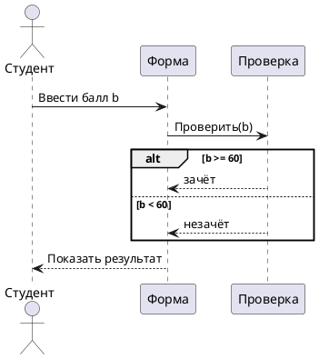

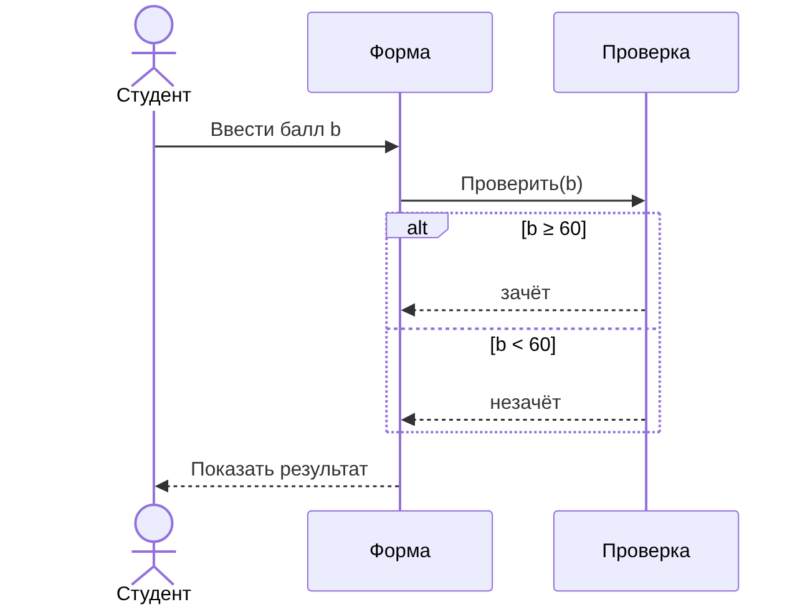

*Рисунок 6 – Сообщения и условный фрагмент alt (диаграмма последовательности)*

Вертикальные линии соответствуют участникам, время идёт сверху вниз. Сплошные стрелки — ввод и передача балла, пунктирные — возврат ответа. Фрагмент alt разделён на две области по условию b ≥ 60.

Для b = 59 проверка возвращает форме «незачёт», для b = 60 — «зачёт». Сообщение «Показать результат» вынесено за границы alt, потому что форма показывает ответ при любом исходе.

### Интеллект-карта профессии программиста

За основу взят профессиональный стандарт «Программист» (06.001). Для карты отобраны три действия, которые встретились в этой работе, и каждому поставлено в соответствие конкретное умение. Например, при отладке проверки балла нужно подобрать значения непосредственно по обе стороны порога.

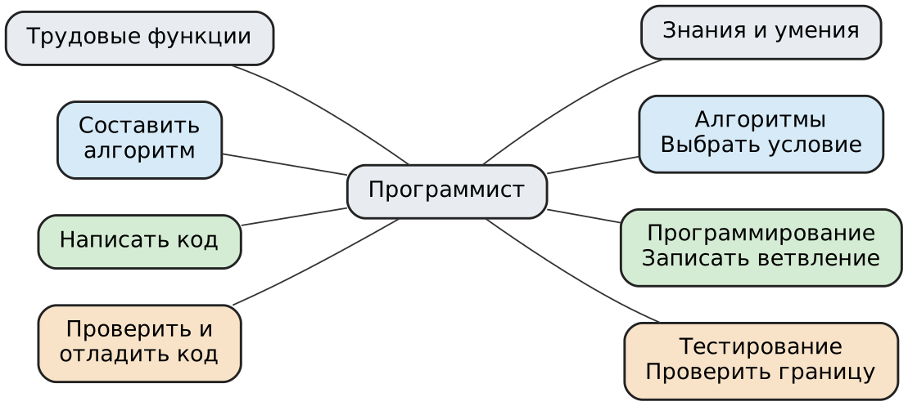

*Рисунок 7 – Трудовые функции слева и знания и умения справа*

Голубая пара связывает составление алгоритма с выбором условия. Зелёная — написание кода с записью ветвления. Оранжевая — проверку и отладку с тестированием границы. Цвет дублирует порядок ветвей, поэтому соответствия читаются и сверху вниз.

Сохранены четыре версии карты (код PlantUML, комментарии с номером версии — после апострофа). В первой есть только корень, во второй добавлены действия, в третьей отдельно собраны знания и умения, в четвёртой обе части объединены и раскрашены. Команда left side переносит ветви функций влево, а символ \n делает подписи компактнее.

```plantuml
@startmindmap
* Программист
@endmindmap

@startmindmap
' v2: добавлены трудовые функции
* Программист
** Составить алгоритм
** Написать код
** Проверить и отладить код
@endmindmap
```

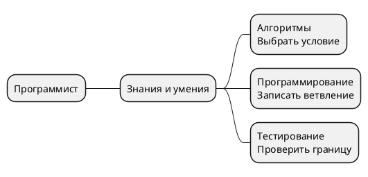

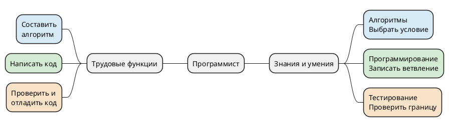

> Рисунки 1–7 построены локально по приведённым описаниям (Graphviz, Mermaid, веб-вёрстка), а не сняты в онлайн-редакторах; в Draw.io, PlantUML и VS Code вид может немного отличаться.

## Вывод

Одна задача представлена с двух сторон. Блок-схема показывает, почему 60 баллов дают зачёт, а диаграмма последовательности — как ответ проверки доходит до студента. Четыре теста подтвердили обе ветви и переход через порог. Карта профессии связывает каждый этап работы с умением, которое для него понадобилось.

## Источники и материалы

- Арьков В. Ю. Цифровые технологии и искусственный интеллект. Учебное пособие. 2024. Глава 3 «Диаграмма как код», с. 74–137.
- [Росстандарт. ГОСТ 19.701–90. Схемы алгоритмов, программ, данных и систем](https://protect.gost.ru/gost/details/0c85e066-f89e-433d-a6d3-b7f746bd0c7c)
- [Минтруд России. Профессиональный стандарт «Программист»](https://mintrud.gov.ru/docs/mintrud/orders/2403)
- [Draw.io. Форматы экспорта диаграмм](https://www.drawio.com/doc/faq/export-diagram)
- [Mermaid. Обозначения для блок-схем](https://mermaid.js.org/syntax/flowchart.html)
- [GitHub Docs. Диаграммы внутри Markdown](https://docs.github.com/en/get-started/writing-on-github/working-with-advanced-formatting/creating-diagrams)
- [Visual Studio Code. Предварительный просмотр Markdown](https://code.visualstudio.com/docs/languages/markdown)
- [Mermaid Ink](https://mermaid.ink/)
- [PlantUML. Диаграммы последовательности](https://plantuml.com/sequence-diagram)
- [PlantUML. Интеллект-карты](https://plantuml.com/mindmap-diagram)
